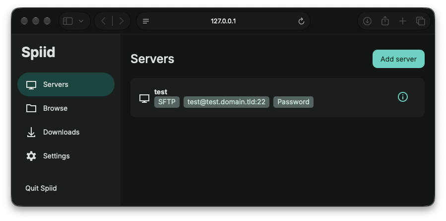

# Spiid



Spiid downloads files and folders from your servers over SFTP, and does it fast.
It splits large files into pieces that download at the same time, downloads
several files in parallel, and continues where it stopped after an interruption.

You start Spiid in a terminal and use it in your browser. The page is served by
Spiid itself on your own computer (127.0.0.1), so it is not reachable from the
internet. Spiid is a single program for macOS, Linux and Windows.

## Features

- Fast: large files are split into segments, and several files download in parallel.
- Resumable: interrupted downloads continue from where they stopped.
- Careful: checks the remote file's size and modification time before and after
  downloading, and never silently overwrites a different local file.
- Safe connections: asks before trusting a new server's SSH host key and refuses
  a key that has changed.
- Efficient: reuses connections to each server.
- Remembers passwords and key passphrases, optionally encrypted with a master password.
- Small: about 7 MB of memory when idle, under 20 MB while browsing or downloading.

## Getting started

### Build

Spiid has no installer. Build it with [Go](https://go.dev) 1.27 or later from the
repository folder:

```sh
go build -o spiid ./cmd/spiid
```

To build for all six supported systems at once, see [Building and testing](#building-and-testing).

### Run

```sh
./spiid
```

Spiid opens your browser and prints a line like this:

```text
Spiid 0.1.0 is running at http://127.0.0.1:PORT/#t=TOKEN — press Ctrl+C to quit
```

Then, in the browser:

1. **Servers** → **Add server**: enter the host, port, user and how to log in.
2. Open the server, browse its folders and select the files or folders you want.
3. Start the download and follow it on the **Downloads** page.

Stop Spiid with Ctrl+C in the terminal or **Quit Spiid** in the page. Interrupted
downloads keep their progress; select them again after restarting to continue.

The `#t=TOKEN` part of the link is a secret that lets only your browser control
Spiid. Each browser tab needs it, so open a new tab with the printed link.

### Options

```sh
spiid                      # open the web UI on a random port
spiid --port 8080          # use a fixed port
spiid --no-browser         # only print the link, don't open a browser
spiid --verbose            # also log every browser request
spiid version              # print the version
```

### On a server without a screen

Run Spiid on the server with `spiid --port 8080 --no-browser`. On your own computer,
open an SSH tunnel with `ssh -N -L 8080:127.0.0.1:8080 yourserver`, then open the
printed link in your browser. Use the same port number on both sides.

### The terminal log

While it runs, the terminal shows what Spiid does: which folders it uses, config
changes, connections, retries, host-key decisions, questions waiting in the
browser and download results. Passwords and the browser token are never logged
(only the first printed link contains the token). For example:

```text
12:00:00  INFO  config: config.json not found — starting with no servers
12:00:00  INFO  started at http://127.0.0.1:8080/
12:01:00  INFO  stopping (Ctrl+C)
12:01:00  INFO  stopped
```

## Pages

| Page | What you do there |
|---|---|
| Servers | Add, edit or remove servers. Log in with ssh-agent, a key file or a password. |
| Browse | Move through remote folders and select files or folders, also from different folders, for download. |
| Downloads | See progress, speed and active threads. Cancel, retry, overwrite a different local file, show a file in its folder, clear finished downloads, or cancel a running folder scan. Adding a finished, failed or canceled file again restarts it. |
| Settings | Choose the theme, download folder, threads per file, parallel files and connections per server. Set, change, remove or reset the master password. See version information. |

## Files Spiid uses

Spiid keeps its configuration in one folder:

- macOS and Linux: `~/.config/spiid` (or `$XDG_CONFIG_HOME/spiid` when that variable is set to an absolute path)
- Windows: `%AppData%\spiid`

| File | What it holds |
|---|---|
| `config.json` in that folder | Settings, servers and saved passwords. Passwords are plain text unless you set a master password; then each one is encrypted (Argon2id + AES-256-GCM). |
| `~/.ssh/known_hosts` | Trusted server host keys. New keys are added only after you confirm them. |
| `<file>.spiid-part` next to a download | The data downloaded so far. |
| `<file>.spiid-state` next to a download | Which parts are done, and which remote file they belong to. |

Only you can read these files (on macOS and Linux: mode 0600 in 0700 folders).
Finished downloads get the usual permissions for new files on your system (your umask).

## Known limitations

- Tested on macOS. The Linux and Windows builds have not yet been tested on those systems.
- Two-factor login: a separate one-time code is not supported. When a server asks
  questions at login, Spiid answers each one with the password.
- A remote file that is rewritten with the same size within the same second
  cannot be detected as changed, because SFTP reports times in whole seconds.
- The programs are not signed. macOS may ask you to allow Spiid in
  System Settings → Privacy & Security.
- Spiid checks the download folder for links before it writes. Another program
  that changes that folder at exactly the same moment could get around these checks.

## Building and testing

Use Go 1.27 or later, from the repository root:

```sh
go test ./...          # run all tests
go test -race ./...    # run all tests with the race detector
bash build.sh          # build all release programs into dist/
```

`build.sh` produces:

```text
dist/spiid-macos-arm64
dist/spiid-macos-amd64
dist/spiid-linux-amd64
dist/spiid-linux-arm64
dist/spiid-windows-amd64.exe
dist/spiid-windows-arm64.exe
```

**Browser test (macOS).** Enable Safari automation once with
`sudo safaridriver --enable`, then run:

```sh
SPIID_E2E=1 go test -count=1 -run TestE2EWebUI ./cmd/spiid
```

**Local test server.** For trying Spiid without a real server, start the
development SFTP server (login `dev` / `dev`) and add it in Spiid as
`127.0.0.1`, port `2222`:

```sh
mkdir -p /tmp/spiid-sample
go run ./cmd/spiid-devserver -root /tmp/spiid-sample -addr 127.0.0.1:2222 -make-sample 3
```

It prints a READY line and its host-key fingerprint; stop it with Ctrl+C. Other
flags are `-user`, `-password`, `-read-delay` and `-known-hosts`; see `-h`. The
`-password` flag exists only for this development server.

## Repository layout

```text
cmd/spiid/              The spiid program: starts the web server and the browser
cmd/spiid-devserver/    Local SFTP server for development
internal/app/           Application logic that the web layer calls
internal/config/        Settings, servers, saved passwords and their encryption
internal/engine/        Download queue, segments and resume
internal/errs/          Shared error kinds
internal/fsutil/        Safe file writes and ~ expansion
internal/logx/          Terminal log
internal/plan/          Turns a selection into a list of files and safe local paths
internal/sftp/          SFTP v3 protocol client
internal/sftptest/      SFTP and SSH servers for tests
internal/sshconn/       SSH login, host keys and connection pools
internal/web/           HTTP API, browser questions and the embedded web page
internal/web/static/    HTML, CSS, JavaScript and fonts of the web page
internal/webdriver/     Browser remote control for the Safari test
build.sh                Builds the release programs into dist/
```

`cmd/` holds the programs you can run; `internal/` holds the code they use. Tests
sit next to the code they test, in `*_test.go` files.

New to the code? Start at `cmd/spiid/main.go`, then read `internal/web`,
`internal/app` and `internal/engine`. The next section explains how they fit together.

## How the code works

This section is for people who change Spiid.

### Overview

```text
browser ⇄ web → app → engine → sshconn → sftp
```

The arrows show the path of a download (all packages are in `internal/`). Next to
this path, `config`, `plan`, `errs`, `fsutil` and `logx` are helpers used by
several packages. `sftptest` and `webdriver` exist only for development and tests.

Lower packages never import higher ones: `web` uses `app`, never the reverse.
The internal dependency order from `go list -deps ./...` is `errs`, `fsutil`,
`logx`, `config`, `sftp`, `sshconn`, `engine`, `plan`, `app`, `web` (independent
packages can appear in another order). `plan` uses `sftp` and `errs`, but not `engine`.

### What happens when you download

1. `internal/web/static/js/pages/browse.js` sends the selection with
   `downloads.add`. `downloadsAdd` in `internal/web/methods.go` calls
   `app.Service.Download` in `internal/app/downloads.go`.
2. `Download` takes a copy of the settings and starts a background scan. Its
   `expand` borrows a pooled SFTP connection and calls `plan.ExpandEach` in
   `internal/plan/expand.go`. The planner walks folders, maps regular files below
   the download folder, and reports skipped names, symlinks and collisions. Scans
   stop at 256 folder levels or 1,000,000 entries. Each scan can be canceled;
   files already queued stay queued.
3. Each file becomes an `engine.Request` passed to `Manager.Add` in
   `internal/engine/manager.go`. The manager limits how many files run at once.
4. `job.run` in `internal/engine/download.go` reads the remote file's details,
   checks local symlinks and existing files, then calls `transfer` for nonempty
   files. A local file with the same size and mtime is skipped; a different one
   needs explicit overwrite permission. Empty files take the `finishEmpty` path.
5. `loadState` in `internal/engine/state.go` checks a saved `.spiid-state`: same
   source, same remote metadata, the right partial-file size and complete segment
   coverage. Without a valid state, `PlanSegments` in `segments.go` splits the file
   into ranges (at least 1 MiB by default), and `openPart` in `part.go` creates a
   new partial file, failing if one already exists.
6. `runWorkers` and `runSegment` in `internal/engine/worker.go` borrow pooled
   SSH/SFTP connections and recheck the remote metadata on each attempt.
   `sftp.File.ReadRange` in `internal/sftp/read.go` keeps up to 64 requests of
   32 KiB in flight per range and writes each reply at its offset in the partial file.
7. `saveLoop` calls `saveState` about once a second. It records progress, syncs
   the partial data first, then atomically writes the state file.
8. When all segments are done, `finalCheck` rechecks the remote size and mtime.
   A mismatch fails the job and removes its partial data and state.
9. After another symlink check, `finishPart` syncs and closes the data, sets mode
   and mtime, and publishes the file: a rename when overwriting is allowed,
   otherwise a hard link plus unlink, so a file that appeared meanwhile is never
   replaced. Without hard links (for example on exFAT) it checks the target again
   and renames. The state file is then removed. Errors and cancellation keep
   resumable progress, unless the remote file changed.

### The web layer

`Server` in `internal/web/server.go` owns `app.Service`, HTTP, event streams and
browser questions.

Security of the local page:

- It listens only on `127.0.0.1` and checks the exact Host header, including the port.
- A random token, created at startup, is in the fragment of the first link. The
  page keeps it for that tab and sends it as an `Authorization: Bearer` header.
  Only `GET /api/events` may pass it as `?t=TOKEN` instead, because EventSource
  cannot send headers.
- The browser is opened through a private temporary HTML file, so the token is
  never on a command line. The file is removed after 30 seconds or at shutdown.
- POST requests need the exact local Origin and `application/json`, with a 1 MiB
  body limit.
- The content security policy allows only this origin (plus data images) and
  forbids framing; nosniff and no-referrer headers are set.
- There is no TLS, because the connection never leaves the computer. Traffic to
  servers is encrypted by SSH; remote use goes through an SSH tunnel.

`api.go`, `methods.go`, `prompts.go` and `wire.go` implement three endpoints:

- `POST /api/call`: `{method, params}` → `{result}` or `{error}`. Methods:
  `local.list`, `local.reveal`, `app.quit`, `app.info`,
  `servers.list`, `servers.add`, `servers.update`, `servers.remove`,
  `settings.get`, `settings.save`, `credentials.status`, `credentials.protect`,
  `credentials.change`, `credentials.unprotect`, `credentials.reset`, `browse.list`,
  `downloads.add`, `downloads.state`, `downloads.clear_finished`, `downloads.cancel_scan`,
  `downloads.cancel`, `downloads.retry`, `downloads.overwrite`.
- `POST /api/answer`: `{id, answer}` answers a pending question and returns 204.
- `GET /api/events`: server-sent events (`events.go`). A reconnecting stream gets
  the questions that are still pending again; there is no event history.

When SSH login needs an answer, it calls `Prompter`. `prompter.wait` in
`prompts.go` registers the question and sends it over the event stream.
`js/prompts.js` in the browser shows a dialog, and `js/api.js` posts the answer.
Cancellation and shutdown release anyone waiting, and reconnects never lose a
pending question.

`static.go` embeds `internal/web/static`:

- `index.html`: page shell that loads everything else.
- `css/theme.css`: colors, typography and fonts.
- `css/layout.css`: page, side rail and responsive layout.
- `css/components.css`: shared controls, dialogs and cards.
- `js/main.js`: startup and page switching.
- `js/api.js`: JSON calls, answers and the event stream.
- `js/rail.js`: navigation and Quit Spiid.
- `js/dom.js`: DOM and control helpers.
- `js/icons.js`: inline Material Symbols icons.
- `js/format.js`: size, speed and time formatting.
- `js/prompts.js`: host-key and password dialogs.
- `js/local_picker.js`: local folder picker.
- `js/virtual_list.js`: renders only the visible rows of long lists.
- `js/pages/servers.js`: server list.
- `js/pages/server_form.js`: server editor.
- `js/pages/browse.js`: remote folder browsing.
- `js/pages/selection.js`: selections across remote folders.
- `js/pages/downloads.js`: download list and status updates.
- `js/pages/job_card.js`: progress and actions of one download.
- `js/pages/settings.js`: preferences and About.
- `js/pages/master_password.js`: master password controls.
- `fonts/`: Inter in four weights, with its license `OFL.txt`.

### Packages

#### internal/app

`Service` is the application facade that the web layer calls; it is safe for
concurrent use. `Options` supplies paths, logging and a `Prompter`; `New` loads
the configuration and creates the SSH and download managers. Server edits are
serialized separately from state reads. `Close` cancels running scans before
closing downloads and connection pools. `SaveSettings` validates and saves
settings; server edits keep saved passwords and login kinds consistent. Retry
forgets cached session passwords so a rejected one is asked for again. Tests
cover browsing, edits, settings, credentials and complete downloads.

#### internal/config

`Store` reads and atomically writes the one `config.json` with settings, servers
and saved secrets. A missing file means defaults; a damaged file is an error.
The file is written with mode 0600 in a 0700 folder; a file others can read
causes a warning. `Server` normalizes and validates connections; `Settings`
normalizes preferences. `DefaultDir` returns AppData on Windows, otherwise an
absolute `XDG_CONFIG_HOME` or `.config/spiid` in the given home folder.

Secrets are plain text until `Protect` sets a master password. Then Argon2id
derives a 256-bit key, and AES-256-GCM encrypts each secret with a fresh nonce
and a fixed AAD. KDF parameters are bounded on load. After unlocking, the key
stays in memory; while locked, settings and servers can still be saved and the
encrypted values are kept. `ChangeMaster` and `Unprotect` require the current
password. `Reset` removes the master password and deletes every saved secret.
Tests cover saving, permissions, validation, damaged files, encryption,
tampering and concurrent updates.

#### internal/engine

`Manager` owns the queue and the parallel-file limit. `Job` is a snapshot for the
page, `Request` a remote/local file pair, and `Segment` a half-open byte range
with its progress. Each running job keeps the settings it started with. Keep
these safety rules:

- Resume requires the same host, port, user, remote path, size and mtime, a
  regular partial file of the expected size, and valid contiguous segments.
- Never take over or overwrite sidecar files Spiid did not create. `ownsSidecars`
  recognizes an old state file that decodes and matches the remote path and size;
  that allows restarting its partial data, but not resuming from another source.
- `checkLinks` uses Lstat on targets, sidecars and folders below the download
  folder before writing, and again before publishing.
- Matching existing files are skipped. Different files need Overwrite, and
  publishing without it must not replace a file that appeared meanwhile.
- Only `ConnectionLost`, `Protocol` and `Other` errors are retried, after 1, 2
  and 4 seconds by default; progress resets the wait. Cancellation interrupts
  waits and blocked transfers.

`resume_test.go`, `safety_test.go`, `part_test.go`, `state_test.go` and
`errors_test.go` test these rules, including changed sources and foreign files.
The Lstat checks do not protect against an attacker changing local paths at the
same moment.

#### internal/sshconn

`Manager` owns the connection pools and the login state of the session; `Pool`
limits the reusable `Conn` objects per server. Return healthy connections with
`Put` and discard broken ones. Host-key checks in `hostkey.go` ask through
`Prompter` about unknown keys, save only accepted keys and refuse changed keys.
Login supports ssh-agent, key files and passwords, with passphrase and
master-password questions. A rejected saved password is asked for again; if
saving a working password fails, Spiid warns but keeps the connection.
Keepalives run every five seconds and close a connection after three missed
replies. To interrupt blocked protocol I/O, close the SSH transport before the
SFTP client. Tests cover host keys, login, pools and keepalives. Secrets must
never appear in command lines or logs.

#### internal/sftp

`Client` implements SFTP v3: packet framing, request IDs, reply dispatch and
operations. `File.ReadRange` pipelines reads and handles short replies. Packets
are limited to 256 KiB, and malformed packets and attributes are rejected.
Closing the client alone cannot unblock transport I/O; its owner must close the
transport. Tests cover malformed packets, attributes, status codes, concurrent
requests, short reads and OpenSSH compatibility.

#### internal/plan

`ExpandEach` walks one selection and hands each file to the queue as soon as it
is found (`Expand` collects them into lists instead). `SafeName` and the local
path checks in `safe.go` reject names that are unsafe on any supported system
(Windows device names such as `CON` or `COM1`, trailing dots and spaces,
`<>:"/\|?*`), Spiid's sidecar suffixes, paths that escape the download folder,
and local symlinks. The walker skips symlinked folders and non-regular files,
and detects names that only differ in case. Keep these checks even if your
system accepts a name. Tests cover trees, unsafe selections, collisions and
cancellation.

#### internal/errs

`Error`, `Kind`, `KindOf` and `Kind.Permanent` classify errors for all packages.
Wrapping must keep the kind, because retries depend on it rather than on error
text. JSON uses stable snake_case kind names. Tests cover wrapping, cancellation
and permanent versus temporary errors.

#### internal/fsutil

`WriteFileAtomic` writes a temporary file next to the target, syncs, sets
permissions, closes and renames it, and removes the temporary file on failure.
Callers create the parent folder. `ExpandHome` expands only a leading `~`.
Tests check atomic replacement, permissions and expansion.

#### internal/logx

`Logger` writes timestamped terminal lines one at a time, with DEBUG lines only
in verbose mode, and replaces control characters. Code logs events where they
happen, never with passwords or passphrases. Tests check cleaning, formatting
and that messages contain no secrets.

#### internal/sftptest

`Serve` runs the local SSH/SFTP server used by tests and `spiid-devserver`. Its
options can slow down or fail reads on purpose. It is a test tool, not a
production SFTP server; serve only temporary folders with it.

#### internal/webdriver

`Client` is a minimal WebDriver client for the Safari test: sessions, browser
actions and screenshots. It is not part of the program.

### Design choices

- One static program with the web page built in. CGO is off, so it
  cross-compiles for every system.
- A browser page instead of a desktop UI keeps the program small and its memory use low.
- `golang.org/x/crypto` is the only direct external module (`x/sys` comes with it).
- Spiid has its own SFTP v3 client, which gives pipelined range reads without
  another library.
- One config file works the same on every system. Optional Argon2id and
  AES-256-GCM encrypt each saved secret, without depending on a system keychain.
- Five-second keepalives detect dead connections quickly instead of waiting for
  long network timeouts.
- Plain HTTP on 127.0.0.1 avoids local certificates; Host, Origin and token
  checks protect the API.
- Size and whole-second mtime are cheap ways to notice remote changes, but they
  cannot detect a same-size rewrite within one second.

### Testing

Tests live next to the code in `*_test.go` files; see
[Building and testing](#building-and-testing) for the commands. The in-process
`sftptest` server makes SSH/SFTP behavior repeatable. Protocol tests also run
against OpenSSH's `/usr/libexec/sftp-server` when it exists and skip it
otherwise. The Safari test drives the real page against local test data.

Tests must never touch the real home folder, `.ssh` or `.config`. Use temporary
folders, path overrides and isolated environment variables, like the existing
test helpers do.

### Common changes

- **Add a web method:** register it in `methodTable` in `methods.go`, decode its
  parameters, call the `app.Service` method, and add tests. Update the browser
  code that calls it and the method list above.
- **Add a setting:** extend `config.Settings` with its default and validation,
  pass it through `app.SaveSettings` to where it is used, update
  `js/pages/settings.js`, and test saving and invalid values.
- **Change a page:** edit its module in `js/pages/` and the shared CSS it uses.
  Keep keyboard access and long-list rendering working. Run the package tests
  and the Safari test.
- **Release:** run the tests, then `bash build.sh`, and check all six programs in
  `dist/`. Building on one system does not prove that Linux or Windows behave
  correctly.

## Credits and licenses

- [LocalSend](https://localsend.org): design inspiration (Apache-2.0).
- [Inter](https://rsms.me/inter/) by Rasmus Andersson: SIL Open Font License 1.1,
  in `internal/web/static/fonts/OFL.txt`.
- [golang.org/x/crypto](https://pkg.go.dev/golang.org/x/crypto): BSD-3-Clause.
- [Material Symbols](https://fonts.google.com/icons): Apache-2.0.

## License

MIT — see [LICENSE](LICENSE).
